# Funcionalidades

Qué hace el sistema, pantalla a pantalla, en la versión congelada (`79f029e`,
que se publica como `v1.0.0`). Todas las capturas son de producción, con la
misma ventana (1280×800 a escala 2); qué enseña cada una, cuándo se hizo y
cómo se repite, está en [su índice](img/capturas/README.md). Cada criterio de
los requisitos, con su estado, está en la
[tabla de estado](arquitectura.md#estado-de-los-requisitos).

La web tiene cuatro pantallas, una por pestaña: Asistente, Analizar, Historial y
Sistema. A la derecha de la cabecera, un indicador dice si responden las APIs
externas que se sondean.

## Analizar un titular

Se escribe un titular y, si se tiene, el texto de la noticia, y se analiza. No
hay ningún modelo de lenguaje de por medio: se llaman todas las señales y se
contrastan entre sí. Cuatro botones rellenan el formulario con ejemplos: un
*clickbait* claro, un titular factual, un caso ambiguo y uno en español.

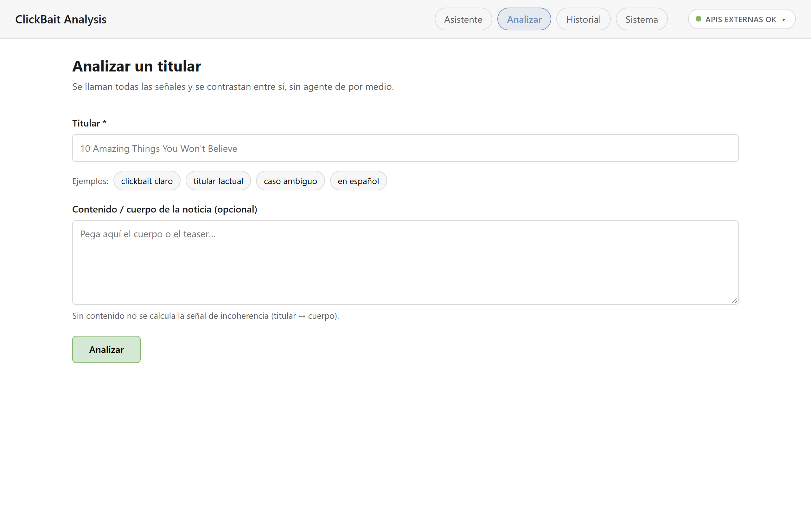

El resultado empieza por el veredicto y el titular, con las pistas del léxico
marcadas según su tipo (por ejemplo, un número inicial, una hipérbole o una
referencia vaga). En español, donde el léxico no se aplica, el titular sale sin
marcas. El veredicto responde a dos preguntas:

- **¿Tiene la forma del *clickbait*?** Lo deciden el léxico, el modelo lineal y
  el modelo dedicado, si analizan el idioma del titular.
- **¿Engaña respecto a su texto?** Lo decide la incoherencia entre el titular y
  el texto, y sólo si hay texto.

De ahí salen cinco veredictos: **Engañoso**, **Clickbait de forma**,
**Factual**, **Ambiguo** y **Sin datos**. El desacuerdo se enseña, no se
promedia:

- si las señales de la forma no coinciden y nada detecta engaño, el veredicto es
  «Ambiguo», y lo mismo si el engaño contradice a una forma unánime;
- sólo cuando la forma está dividida y la incoherencia detecta engaño, ésta
  desempata, y el veredicto es «Engañoso».

El tono (positivo, neutro o negativo) se muestra, pero no vota.

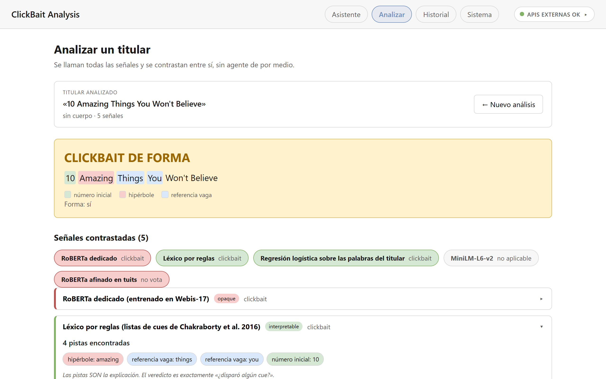

Debajo va una tarjeta por señal. Cada una dice de qué tipo es (*interpretable*,
*hybrid* u *opaque*) y lo que da a cambio:

- el léxico, las pistas que encontró;
- el lineal, cuánto empuja cada palabra hacia el *clickbait* o en contra;
- la incoherencia, la similitud entre el titular y el texto;
- los modelos afinados, su confianza, y que son una caja negra.

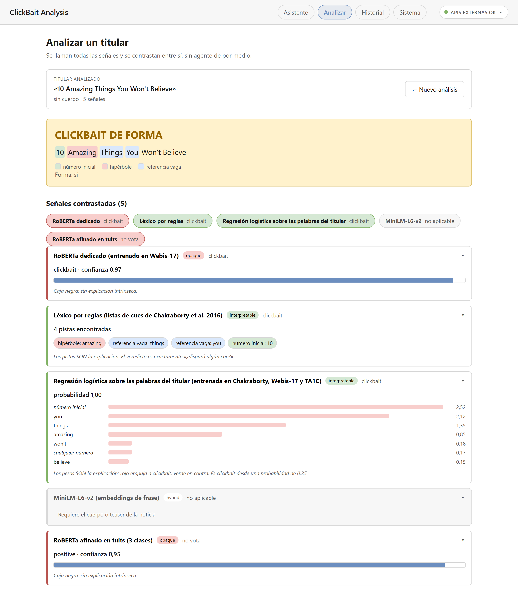

En el caso ambiguo, las señales de la forma no coinciden, y el veredicto lo dice
en vez de elegir una:

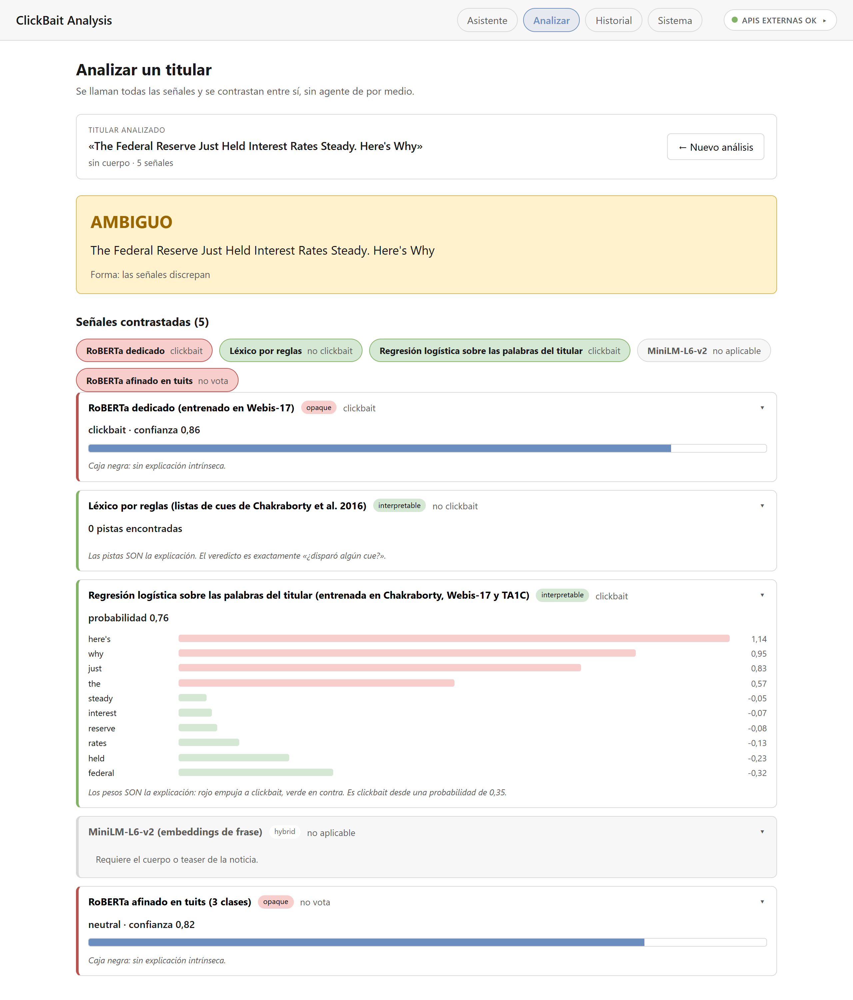

En español se usan otros modelos: BETO afinado con el corpus TA1C, el modelo
lineal, que es bilingüe, y otro modelo de tono. El léxico y la incoherencia no
analizan el español, y cada tarjeta dice por qué. Un titular en otro idioma no
lo analiza ninguna señal, y su veredicto es «Sin datos».

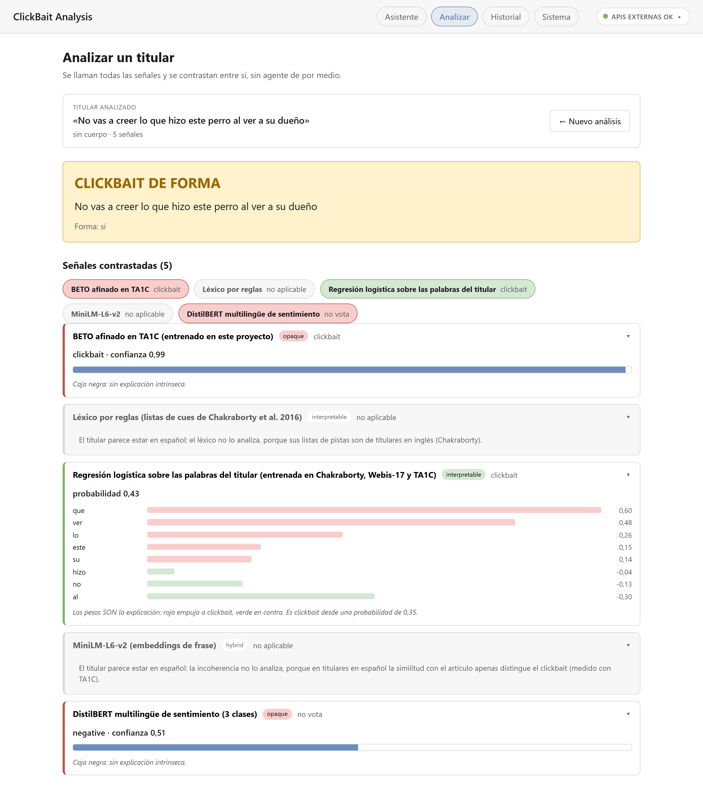

El indicador de la cabecera se despliega con el estado de cada API externa que
se sondea: la del tiempo, The Guardian y The New York Times. GNews y NewsData.io
no se sondean. Avisa además de que las señales de análisis no se sondean ahí.

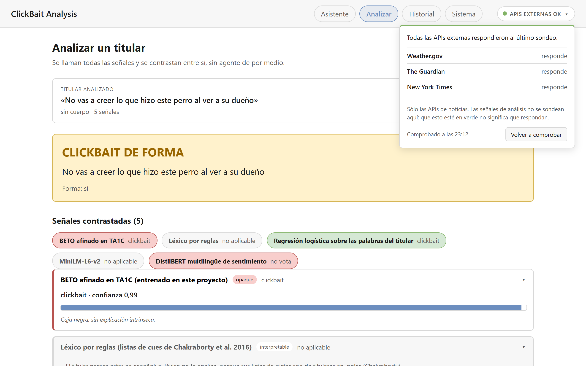

## Historial

Cada análisis y cada ejecución suelta de una herramienta quedan guardados. Se
filtran por tipo, por veredicto y por cómo terminó la ejecución, y se pasan por
páginas. Un análisis se vuelve a abrir tal como salió. Lo que hace el asistente
no se guarda.

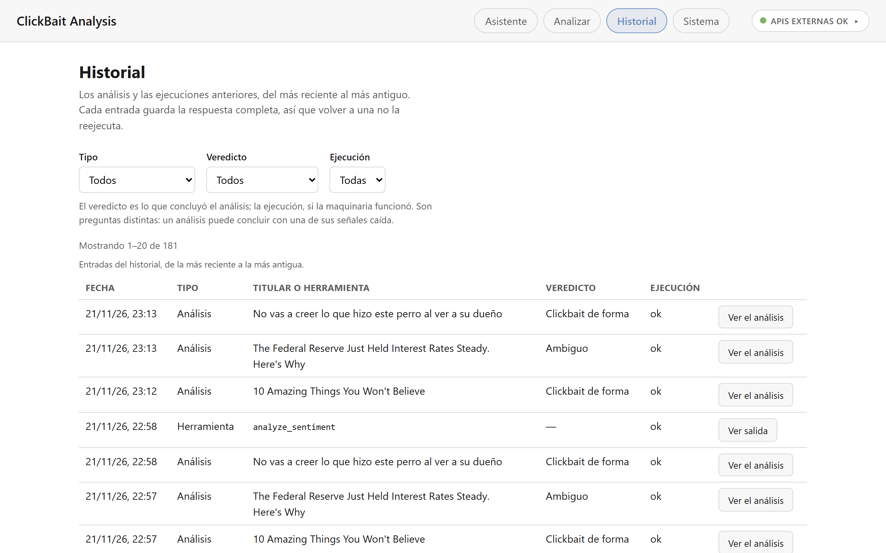

## Sistema

Lo que hay detrás:

- **los servidores MCP conectados**, con cuántas herramientas publica cada uno;
- **el catálogo de herramientas**, con un buscador y un filtro por categoría;
- **las fichas de los modelos**: su nombre, su tarea y sus límites medidos.

El catálogo se construye preguntando al servidor MCP, sin ninguna lista escrita
en la web.

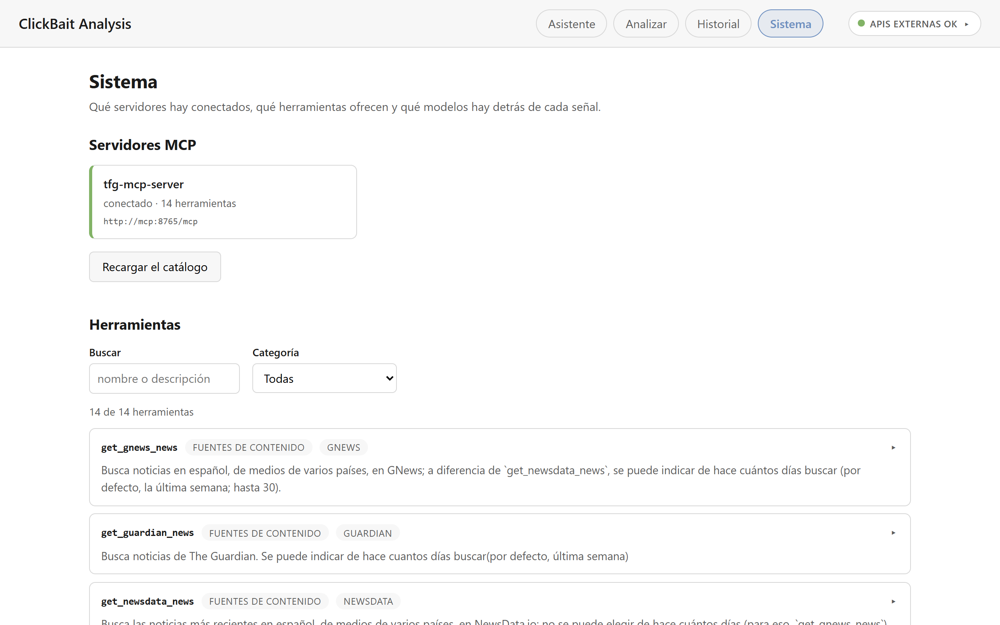

Cada herramienta se puede ejecutar suelta, con un formulario que sale del
esquema que publica, y se ve la respuesta tal cual:

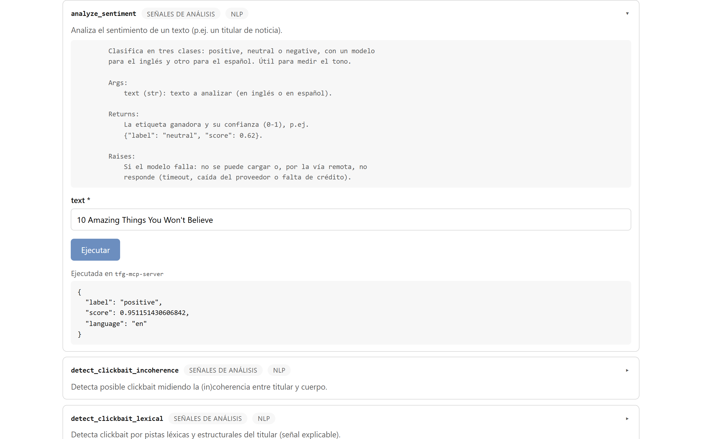

## El asistente

Se pregunta en lenguaje natural. El asistente, un modelo de lenguaje local
(`qwen3.5:27b`, servido por Ollama en una GPU de la universidad), elige qué
herramientas usar y cuenta lo que devuelven. El veredicto sale de las
herramientas, no de su texto.

Por cada pregunta se ve lo que consultó y después su respuesta. El resultado de
una señal o de un análisis completo sale con su tarjeta; las noticias, como una
lista de enlaces; y lo demás, tal cual. Si una respuesta no se apoya en ninguna
herramienta, la pantalla lo avisa. La conversación se guarda en la pestaña del
navegador, y «Empezar una conversación nueva» la vacía. En «Sobre el asistente»
están su ficha y el prompt de sistema que usa.

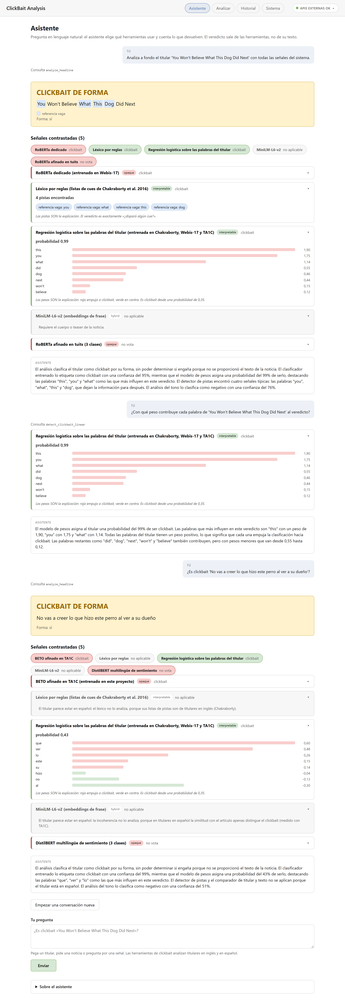

La captura con las tarjetas abiertas es
[`12-asistente-conversacion-tarjetas.png`](img/capturas/12-asistente-conversacion-tarjetas.png).

La GPU es compartida y se enciende bajo demanda. Sin ella, la pantalla dice que
el asistente está apagado y por qué, en vez de ofrecer un chat que fallaría. El
análisis sigue en Analizar.

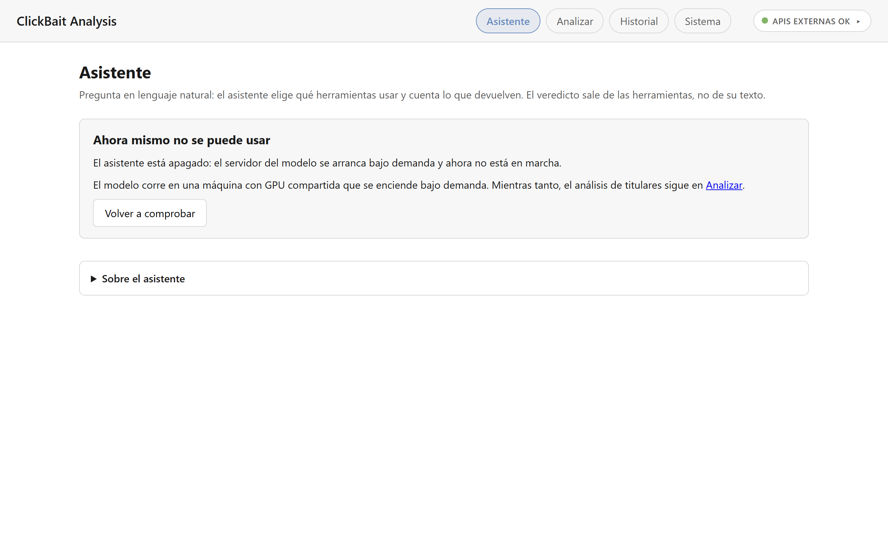

Para la demostración hay además un modo con las respuestas grabadas del modelo,
que reproduce una conversación ensayada con las herramientas de verdad. La
pantalla lo avisa siempre ([`demostracion.md`](demostracion.md)).

## Fuera de la web

- **La API REST**: lo que hacen las pantallas (analizar, el catálogo, ejecutar
  una herramienta, el historial, el asistente), documentado con OpenAPI en
  `/api/docs`.
- **El servidor MCP**: las mismas catorce herramientas, para cualquier cliente
  MCP. Por ejemplo, Claude Desktop ([`ejecucion.md`](ejecucion.md#desde-claude-desktop)).
